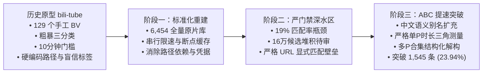
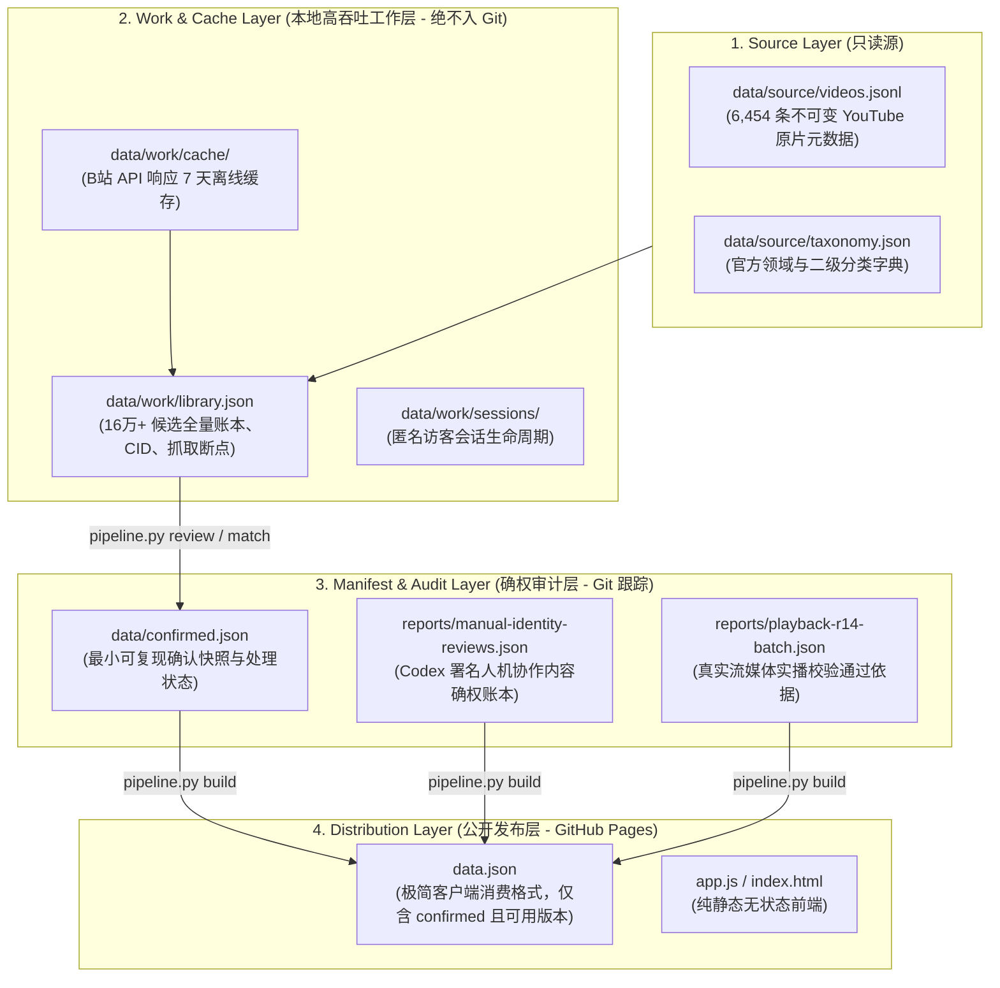
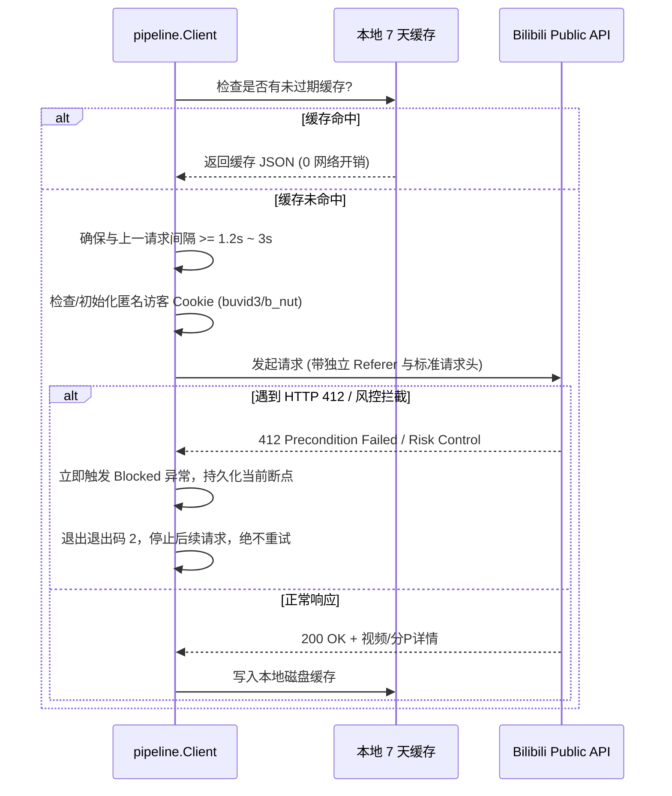
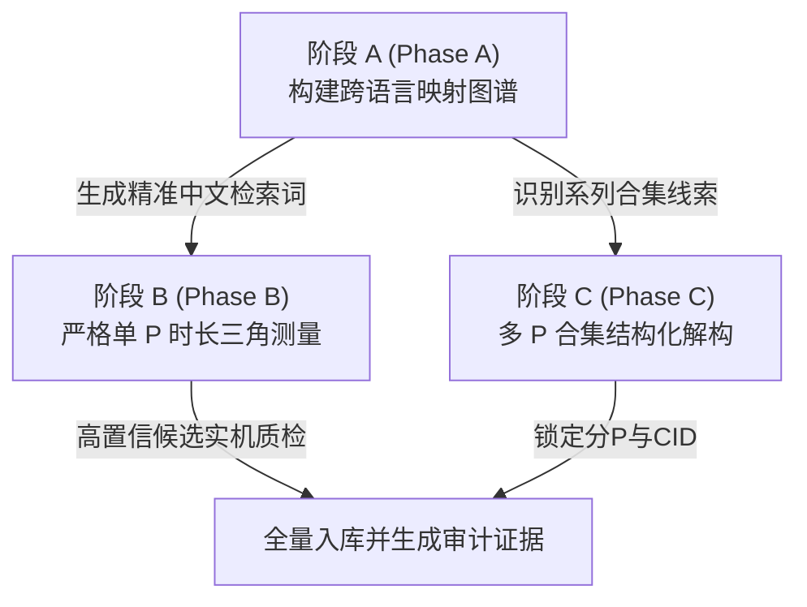
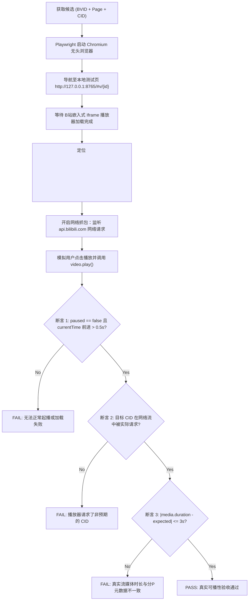

# youtobili 全流程工程开发经验复盘与方法论总结

> 本文系统梳理了 youtobili（基于 HackerTube 精选高质量技术/科普内容，定位国内 B 站高可用原声与熟肉映射站点）从立项交接到大规模工业化推进全过程沉淀的工程经验、技术洞见、质量防护与避坑指南。

---

## 目录
1. [项目演进全景：从原型到工业化流水线](#一项目演进全景从原型到工业化流水线)
2. [数据分层与架构设计：四层流转与零泄漏原则](#二数据分层与架构设计四层流转与零泄漏原则)
3. [逆向工程与反爬风控治理：柔性避障与会话管理](#三逆向工程与反爬风控治理柔性避障与会话管理)
4. [核心核验方法论：ABC 跨语言对齐范式](#四核心核验方法论abc-跨语言对齐范式)
5. [质量门禁革命：基于 Playwright 真实播放流的端到端验证](#五质量门禁革命基于-playwright-真实播放流的端到端验证)
6. [测试与工程保障：三位一体的回归体系](#六测试与工程保障三位一体的回归体系)
7. [关键经验与反模式总结（Pitfalls & Best Practices）](#七关键经验与反模式总结pitfalls--best-practices)

---

## 一、项目演进全景：从原型到工业化流水线



### 1.1 历史遗留问题诊断
在项目接交初期（原名为 `bili-tube`），存在数项阻碍规模化推进的原型期技术债：
- **硬编码路径与环境耦合**：脚本充斥未随仓库归档的 `/workspace/` 宿主路径，无法跨机器无损复现；
- **推断代替核验**：原始数据盲目采信“卡帕西标签（Karpathy Recommended）”或推断标签，缺乏源头链接可溯性；
- **人为门槛导致视野狭窄**：设定的“10 分钟最低时长门槛”过滤了大量计算机科学顶级演示（如 Doug Engelbart 的 1968 The Mother of All Demos、Steve Jobs 1984 Mac 发布片段、IBM 原子电影等经典硬核短片）；
- **全库只有 129 个 BV**：匹配率极低，难以形成知识库规模效应。

### 1.2 工业化改造里程碑
我们通过重建 `scripts/pipeline.py`、解耦数据存储、引入端到端真实测试，实现了从“小作坊手工采集”到“可信工业级流水线”的跃迁：
- **片库全量覆盖**：全量导入 HackerTube 6,454 条精选库，完成 100% 可行原片处理；
- **确认条数指数级跃升**：从最初的 129 条一路扩展至 **1,545 条已确认原片**、**2,003 个已发布分 P 版本**；
- **全库覆盖率突破**：从最初不到 2% 跃升至 **23.94%**（已处理原片匹配率达 24.11%）；
- **100% 具备真实可播断言**：所有线上可访问版本均经过无头浏览器流媒体级别冒烟实测。

---

## 二、数据分层与架构设计：四层流转与零泄漏原则

为了在保障本地高频处理性能的同时，彻底消除安全合规风险（如敏感凭证泄露、本地绝对路径污染、待审脏数据发布），youtobili 设计了清晰的四层数据模型：



### 2.1 架构设计黄金法则
1. **本地临时库与线上发布库物理隔离**：
   - 抓取过程产生的海量候选（165,000+）、原始请求缓存、会话 token 等全部收容于本地 `data/work/` 目录，通过 `.gitignore` 严格排斥在 Git 版本控制之外。
2. **确定性与无损重建**：
   - 新克隆代码库无需依赖庞大的本地工作目录，只需 `data/confirmed.json` 即可直接构建出与线上完全一致的 `data.json`。
3. **零泄露红线**：
   - 发布管道内置 `check()` 强断言：严禁包含任何内部开发路径（如 `/Users/`、`/workspace/`）、未脱敏源文件指纹、旧版不可信置信度标签、以及 B 站登录态 Cookie（`SESSDATA`、`bili_jct`）。

---

## 三、逆向工程与反爬风控治理：柔性避障与会话管理

与国内大型视频平台接口的交互中，风控与反爬治理是决定采集系统能否长期健康运行的命脉。

### 3.1 核心经验与解决方案



1. **解决首次请求 412 拦截：匿名访客会话（Guest Session）**
   - **痛点**：裸 `urllib` 请求 B 站搜索或详情接口时，极易因缺失初始追踪标识触发 HTTP 412 或被重定向至登录页。
   - **解法**：在 `scripts/pipeline.py` 中封装 `Client`，在发起查询前预热访问轻量静态入口，拉取基础 `buvid3`、`b_nut` 匿名访客 Cookie，并在会话生命周期中复用。
2. **串行限速与柔性避障（Polite Throttling）**
   - 严格串行执行，请求间保持 $1.2\text{s} \sim 3.0\text{s}$ 的强制保护间隔。
   - 批次设置硬上限（单批最多 50 条）。
3. **风控熔断而非暴力重试**：
   - 当遇到 412、登录挑战、滑块验证码或 429 限流时，**立刻停止当前批次并优雅保存断点**。
   - 绝不编写自动死循环重试逻辑；风控发生时暴力重试只会将轻度限频升级为 IP 级长效封禁。
4. **多级线索挖掘（Off-API Lead Mining）**：
   - 充分利用离线数据：通过 `seed-identities` 从已缓存的详情描述中提取 YouTube ID 显式线索，通过 `seed-related` 从已收录的多 P 合集中挖掘关联分集，再由 `verify-leads` 定向核验。这使系统在不消耗宝贵搜索频次的前提下，挖掘出数百条高确定性视频。

---

## 四、核心核验方法论：ABC 跨语言对齐范式

在完成初轮处理后，自动化匹配置信度遇到了“19% 覆盖率瓶颈”——这是整个项目最大的工程卡点。

### 4.1 瓶颈根因深度剖析
自动化流水线最初要求“B 站简介必须包含形如 `youtube.com/watch?v=...` 的显式链接”。然而在现实中：
1. **国内 UP 主搬运习惯**：极少人会完整保留 YouTube 原链，更多是将标题直译为中文、加上主讲人中文译名、或者仅标注“搬运自油管”、“TED演讲”、“MIT公开课”。
2. **候选库堆积待审**：超过 14,000 条候选落入 `review` 状态，由于缺乏自动化外键关联，全库处理进度一度停滞。

### 4.2 ABC 提速方法论的诞生与成效
针对此瓶颈，我们总结并落地了 **ABC 跨语言精准对齐框架**：



#### 阶段 A（Phase A）：中文语义与博主别名扩充
- 在 `data/search-queries.json` 中针对知名科普频道与顶级学者构建中文映射表（如 3Blue1Brown $\to$ “三蓝一棕/深度学习/线性代数的本质”，Veritasium $\to$ “真理元素”，Not Just Bikes $\to$ “这就是荷兰”，Andrej Karpathy $\to$ “卡帕西/神经网络入门”等）。
- 将别名库扩充至 1,861 组，大幅激活了冷门与老旧经典搬运视频的搜索召回。

#### 阶段 B（Phase B）：严格单 P 时长三角测量
- **时长基准线**：原片与候选分 P 时长差异绝对阈值设为 $\le \max(60\text{s}, 8\%)$；在深水区提速批次中，进一步收敛至 **$0 \sim 2$ 秒极低误差**。
- **三重证据三角对齐**：
  $$\text{Confidence Score} = f(\Delta\text{Duration} \le 2\text{s}) \land g(\text{Title Keyword Overlap} \ge 40\%) \land h(\text{Author/Channel Match})$$
- 结合有效 CID 校验，确保选中的单 P 候选在内容形态上具备数学级的高概率吻合。

#### 阶段 C（Phase C）：多 P 合集结构化解构
- 杜绝“整 BV 时长等于各分 P 累加”或“盲信上传者分 P 序号”的猜测做法。
- 逐一根据分 P 专属标题、分段简介、章节标记精准提取，将每一个分 P 的 `cid` 与 YouTube 原片 ID 绑定（如 MIT 18.06 Gilbert Strang 线性代数、Talks at Google 演讲、SICP 1986 系列公开课）。

#### 严密的反向拦截规则（Anti-Patterns Catching）
在此过程中，我们建立了一套严密的反模式拦截规则，有效剔除了以下四类伪匹配：
- **二创与翻唱（Cover & Remix）**：过滤标题含有“粤语版”、“翻唱”、“鬼畜”的衍生作品（如将 Rickroll 填词翻唱的作品）。
- **伪装切片短视频**：拦截元数据标示为数千秒、但实际播放器仅为 10 分钟剪辑短片的视频（如 `iJfw6lDlTuA` 课程切片）。
- **微剪辑与删减版**：拦截片头片尾被裁剪十几秒导致时长偏差超过 3 秒的版本（如 `8fHi36dvTdE` 伯恩斯坦演讲）。
- **YouTube 跨账号同源重复搬运冲突**：当 YouTube 原库中存在两个不同频道上传的同一视频时，构建层自动拦截跨原片同一分 P 冲突，保持主原片优先，释放隐藏版本。

---

## 五、质量门禁革命：基于 Playwright 真实播放流的端到端验证

> [!IMPORTANT]
> **核心工程真理**：接口元数据匹配成功，绝不等于视频在客户端真实可播！

在很多视频聚合项目中，最常出现的故障是“元数据全对，但用户点开后黑屏、失效或提示充电专属”。youtobili 将 **Playwright 无头浏览器真实播放检测** 作为最高级别的放行准则。



### 5.1 自动化播放质检的断言矩阵
为保证发布质量，我们编写了专用的 `scripts/test_playback_batch.cjs`，针对每一个新入库版本进行四重物理断言：
1. **渲染与状态就绪断言**：`readyState == 4`（`HAVE_ENOUGH_DATA`），视频流已稳定缓冲；
2. **起播与前进断言**：模拟用户手势触发 `play()`，检测 `paused == false` 且在 $2.5\text{s}$ 内 `currentTime` 稳定向前推进超过 $0.5\text{s}$；
3. **真实流媒体时长吻合断言**：读取底层 `<video>` 元素的 `duration` 浮点数，与分 P 元数据时长比对，误差必须 $\le 3\text{s}$（瞬间击穿任何虚假元数据）；
4. **底层流媒体 CID 嗅探断言**：监听浏览器发出的所有网络请求，断言目标分 P 的真实 `cid` 必须出现在流媒体分片请求参数中，防止 B 站默认跳回 P1 造成假阳性。

在 Round 14 的提速过程中，**全部 306 个新确认原片版本均 100% 通过了该项严苛实测**。

---

## 六、测试与工程保障：三位一体的回归体系

在日常持续集成中，任何微小的代码变更都必须在发布前通过“三位一体”全套质检体系：

```
       ┌────────────────────────────────────────────────────────┐
       │              youtobili 质量金字塔                      │
       ├────────────────────────────────────────────────────────┤
       │ 1. 业务逻辑与风控断言: 79 项 Python 单元测试 (3.1s)      │
       │    • 覆盖 412 拦截恢复、缓存命中、合集拆解、版本降级等     │
       ├────────────────────────────────────────────────────────┤
       │ 2. 端到端渲染与体验: 15 项 Playwright 浏览器场景测试      │
       │    • 覆盖桌面/移动视口、无横向溢出、主题切换、本地存储迁移 │
       ├────────────────────────────────────────────────────────┤
       │ 3. 生产级发布与对齐: SHA-256 跨网络严格散列一致性校验    │
       │    • 本地 data.json 哈希 === GitHub Pages 部署产物哈希  │
       └────────────────────────────────────────────────────────┘
```

### 6.1 单元测试（Unit Tests）
- 位于 `tests/test_*.py`，共 79 项测试用例，覆盖全部确定性函数。
- 模拟 HTTP 412 拦截恢复、离线缓存复用、多 P 拆解与绑定逻辑、数据迁移兼容。
- 极速执行（本地运行仅需 3.1 秒），作为高频修改的第一道防线。

### 6.2 端到端浏览器测试（E2E Browser Tests）
- 位于 `tests/browser.cjs`，驱动真实 Chromium 渲染生产产物。
- 覆盖 15 项真实交互场景：
  - 桌面宽屏卡片流与移动端无横向滚动条适配；
  - 真实 B 站封面 CDN 图片 HTTP 加载测试；
  - 中文分类筛选、关键字高亮、空状态反馈；
  - 旧版 `BV...` 兼容深层跳转与 URL Hash 路由；
  - 本地历史记录、收藏夹与深浅色模式持久化；
  - 原片多版本下拉切换与按 `ESC` 移除嵌入式 Iframe 播放器。

### 6.3 部署后哈希一致性验收（Hash Verification）
- 构建产生 `data.json` 后，计算本地 SHA-256：
  ```sh
  shasum -a 256 data.json
  ```
- 通过 GitHub Actions 部署完成后，脚本自动拉取公开 CDN 产物并再次比对：
  ```sh
  curl -sL "https://farmland2049.github.io/youtobili/data.json" | shasum -a 256
  ```
- 只有两个十六进制哈希完全逐字一致，本次发布才被判定为最终成功。

---

## 七、关键经验与反模式总结（Pitfalls & Best Practices）

| 场景 / 维度 | ❌ 容易踩坑的反模式（Pitfalls） | ✅ 经过验证的最佳实践（Best Practices） |
| :--- | :--- | :--- |
| **反爬对抗** | 遇到请求失败立刻 while 循环重试，多线程并发刷接口 | 建立匿名会话 Cookie，设置 1.2s~3s 串行缓冲，遇到 412/风控立刻熔断存断点 |
| **视频匹配** | 仅比较视频标题文本相似度，或凭借 AI 大模型推测批准 | “时长误差 $\le 2\text{s}$ + 核心词重合 + 频道对应”三角验证，辅以实播门禁 |
| **多 P 合集** | 比较合集总时长，或根据分 P 序号猜测原片对应集数 | 必须依靠分 P 标题、分段简介定位原片 ID；整 BV 粗暴认领必须置于待审 |
| **二创与微剪** | 认为时长差在允许范围内（如相差10几秒）就直接放行 | 严格排查“翻唱/粤语/解说”字样，借助 Playwright 实播流抓出微剪切片 |
| **数据管理** | 将调试日志、抓取断点、个人凭证混入公开提交 | 遵循四层数据模型，工作数据与确认账本严格物理隔离，构建脚本内置安全断言 |
| **跨原片冲突** | 多个原片条目争夺同一个 B 站热门 BV 分 P，导致相互覆盖 | 构建管道检测跨原片相同分 P 冲突时自动全部隐藏保护，人工介入确定权威版本 |
| **会话接续** | 依赖 Agent 模糊上下文，重复执行已失败或未授权动作 | 基于 Git 分支与 `reports/CONTINUATION.md` 确定性快照交接，每轮留存实播证据 |

---

## 结语

youtobili 的开发历程证明：**在开放网络数据的聚合与跨平台内容确权场景中，确定性的工程约束、细致的会话治理、以及基于底层真实流媒体的端到端自动化测试，是构建高可用、零缺陷数据产品的唯一可靠路径**。这套方法论不仅支撑了当前 1,545 条高质量原片的扎实发布，也为未来向全库 100% 推进奠定了坚不可摧的基础。
